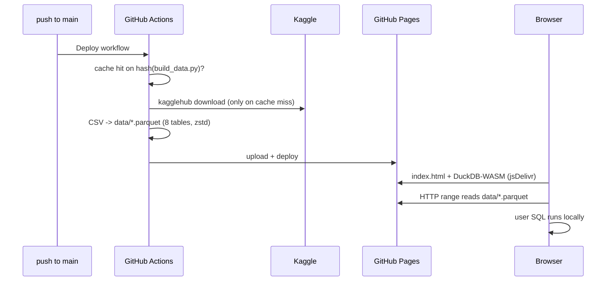

# sql-business

I wanted a website that gives me proper business problems to practice my SQL on. Not just "here is the table, generate it with SQL". That's what I am building.

Live at: **https://sqlbusinessproblems.karthikiyer.info** _(pending)_

---

## 1. What it is

A SQL practice site built around **business problems, not syntax drills**.

- You get a problem statement the way an executive would ask it ("Why did repeat revenue drop in Q3?").
- You get snippets (first few rows) of each relevant table.
- You answer in **multipart queries** — each part builds toward the final answer.
- An "executive" nudges you along the way: hints framed as business guidance, not SQL answers.
- Final check: your output matches the expected result → ✅. If not, you see what the output *should look like* (shape, columns), not the answer query.

## 2. How a problem works

```
Problem statement (business context)
   |
   v
Table snippets  ->  Part 1 query  ->  check  ->  Part 2 query  ->  check  -> ... -> Final ✅
                         |                           |
                         └── exec hint on miss ──────┘
```

## 3. Dataset

[Olist Brazilian E-Commerce](https://www.kaggle.com/datasets/olistbr/brazilian-ecommerce) — ~100k real orders (2016–2018) across customers, orders, order items, payments, reviews, products, sellers, category translations. Geolocation table dropped (size).

License: CC BY-NC-SA 4.0 → this site stays non-commercial; derived data shared under same license.

## 4. Architecture

Static site. SQL runs **in the browser** (DuckDB-WASM). No backend, no data in git.



**Deploy (GitHub Actions, once per push to `main`)**

1. Push to `main` triggers `.github/workflows/deploy.yml`.
2. Cache check, keyed on hash of `scripts/build_data.py`:
   - hit → reuse `data/`, skip Kaggle (most pushes)
   - miss → download (first run, script changed, or cache unused 7 days)
3. `kagglehub` downloads Olist using the `KAGGLE_API_TOKEN` repo secret.
4. `scripts/build_data.py` converts 8 CSVs → `data/*.parquet` (zstd, ~22 MB).
5. Site (`index.html` + `data/`) deployed to GitHub Pages.

**Visit (user's browser, every page view)**

6. Browser loads `index.html` from Pages + DuckDB-WASM engine from jsDelivr (cached after first visit).
7. Each table is a view over `data/<table>.parquet`, read via HTTP range requests — only the bytes a query touches are fetched.
8. User SQL runs locally in their tab. `DROP`/`DELETE` only affect that tab; refresh restores.

| Who | Talks to | When |
|---|---|---|
| GitHub Actions | Kaggle | Cache miss only |
| GitHub Actions | Pages | Every deploy |
| Browser | Pages, jsDelivr | Every visit |
| Browser | Kaggle | Never |

## 5. Problem format

_TBD_ — each problem = statement, tables used, parts (prompt + expected result + hints), final expected output.

## 6. Hosting

- GitHub Pages (source: GitHub Actions), custom subdomain `sqlbusinessproblems.karthikiyer.info`.
- DNS: `CNAME sqlbusinessproblems → karthikiyer365.github.io` in Netlify DNS (zone `karthikiyer.info`), same pattern as `projects` / `writing`.

## 7. Local development

_TBD_

## 8. Adding a problem

_TBD_

## 9. Roadmap

- [ ] Pick dataset + SQL engine
- [ ] Subdomain live on Netlify
- [ ] First problem end-to-end
- [ ] Hint flow
- [ ] Problem library

## License

See [LICENSE](LICENSE). Dataset license noted in section 3 once chosen.
