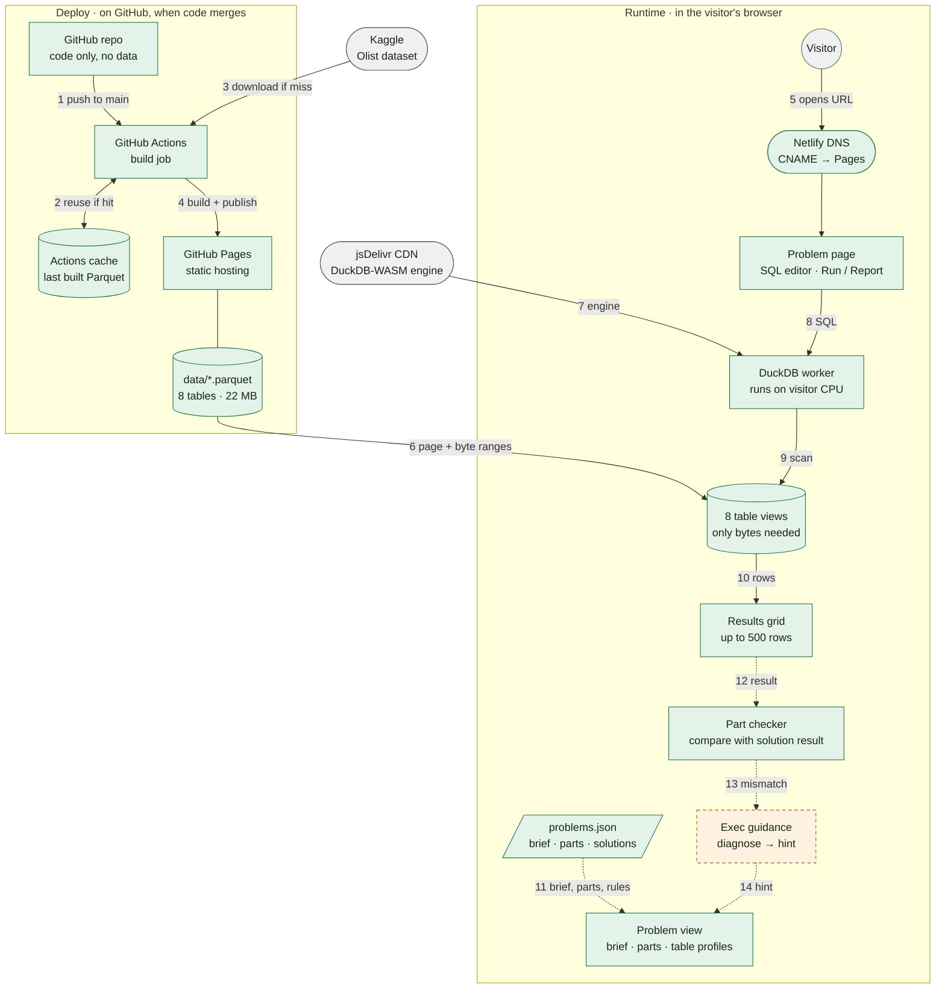
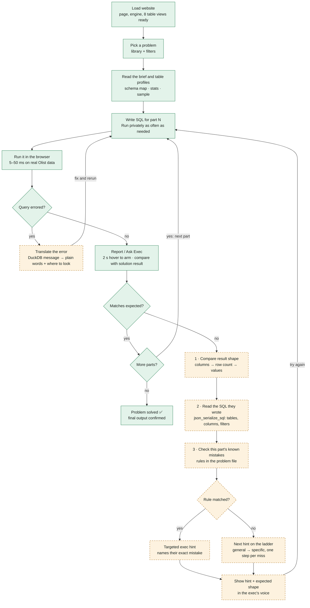

# sql-business

I wanted a website that gives me proper business problems to practice my SQL on. Not just "here is the table, generate it with SQL". That's what I am building.

Live at: **https://sqlbusinessproblems.karthikiyer.info** _(pending)_

---

## 1. What it is

A SQL practice site built around **business problems, not syntax drills**.

- You get a problem statement the way an executive would ask it ("Why did repeat revenue drop in Q3?").
- You get snippets (first few rows) of each relevant table.
- You answer in **multipart queries** — each part builds toward the final answer.
- An "executive" nudges you along the way: hints framed as business guidance, not SQL answers.
- Final check: your output matches the expected result → ✅. If not, you see what the output *should look like* (shape, columns), not the answer query.

## 2. How a problem works

```
Problem statement (business context)
   |
   v
Table snippets  ->  Part 1 query  ->  check  ->  Part 2 query  ->  check  -> ... -> Final ✅
                         |                           |
                         └── exec hint on miss ──────┘
```

## 3. Dataset

[Olist Brazilian E-Commerce](https://www.kaggle.com/datasets/olistbr/brazilian-ecommerce) — ~100k real orders (2016–2018) across customers, orders, order items, payments, reviews, products, sellers, category translations. Geolocation table dropped (size).

License: CC BY-NC-SA 4.0 → this site stays non-commercial; derived data shared under same license.

## 4. Architecture

Static site. SQL runs **in the browser** (DuckDB-WASM). No backend, no data in git.

Green = built and live · dashed amber = planned · grey = outside service.

### System design

Follow the numbers: 1–4 run on GitHub when code merges, 5–14 run in each visitor's browser.



**Deploy (live)**

1. Code merges to `main` → `.github/workflows/deploy.yml` starts.
2. Cache keyed on hash of `scripts/build_data.py`; hit → reuse Parquet, skip Kaggle.
3. Cache miss only (first run, script changed, or cache unused 7 days) → `kagglehub` downloads Olist (42.6 MB) using the `KAGGLE_API_TOKEN` secret.
4. CSVs → `data/*.parquet` (zstd, ~22 MB); site + data published to GitHub Pages.

**Runtime (live)**

5. Visitor opens the URL; Netlify DNS points it at GitHub Pages.
6. Browser loads `index.html`, then reads Parquet in byte ranges (HTTP 206) as queries need them.
7. DuckDB-WASM engine loads from jsDelivr (cached after first visit).
8. Visitor's SQL goes from the editor to the DuckDB worker.
9. Worker scans the 8 table views. `DROP`/`DELETE` only affect that tab; refresh restores.
10. Rows return to the results grid (500-row render cap).

**Problem layer (live, except 13–14)**

11. Problem view loads `problems.json` (brief, parts, solution SQL) and `data/profile.json` (table stats, built at deploy).
12. **Report / Ask Exec** sends the result to the part checker, which runs the part's solution in the browser and compares results. **Run** never reports.
13. *(planned)* On a mismatch, the checker hands the gap to exec guidance. Today: a shape-only message.
14. *(planned)* Guidance picks a hint that fits the visitor's own SQL and shows it in the problem view.

### Runtime flow

One visitor solving one problem. The right branch turns a wrong answer into a hint about what they actually wrote.



**How hints stay relevant (planned, not built yet):** four checks run in the browser in order; the first that finds something decides the hint.

| Check | Looks at | Example exec hint |
|---|---|---|
| Error | DuckDB error message | "There's no order_value. Money lives in order_items.price and order_payments.payment_value." |
| Shape | Column names + row count vs expected | "You handed me a list. I asked for one number." |
| Their SQL | Tables, columns, filters, grouping via `json_serialize_sql` | "Every order gets a fresh customer_id. The real person is customer_unique_id." |
| Ladder | Nothing specific matched | Next hint for this part, more specific each miss |

| Who | Talks to | When |
|---|---|---|
| GitHub Actions | Kaggle | Cache miss only |
| GitHub Actions | Pages | Every deploy |
| Browser | Pages, jsDelivr | Every visit |
| Browser | Kaggle | Never |

## 5. Problem format

All problems live in one file, `problems.json` (an array). One entry:

```jsonc
{
  "id": "repeat-buyers",                 // URL: /#repeat-buyers
  "title": "Repeat buyers",
  "summary": "Card question on the library",
  "level": "easy | medium | hard",
  "dept": "Growth",                      // library filter
  "concepts": ["JOIN", "GROUP BY"],      // library filter
  "minutes": 20,
  "exec": { "role": "Head of Growth", "initials": "HG", "note": "needs this before Monday's budget review" },
  "brief": "The exec's ask, in their words",
  "deliver": "What I need from you",
  "tables": ["orders", "customers"],     // tabs + highlighted on the schema map
  "parts": [
    { "ask": "Part question", "solution": "SELECT …", "win": "Exec line on correct", "ordered": false }
  ]
}
```

A report is correct when the visitor's result has the same rows as the solution's: column names ignored, numbers compared to 2 decimals, row order ignored unless `"ordered": true`. Solutions run in the browser, so they are visible in devtools (the repo is public anyway).

## 6. Hosting

- GitHub Pages (source: GitHub Actions), custom subdomain `sqlbusinessproblems.karthikiyer.info`.
- DNS: `CNAME sqlbusinessproblems → karthikiyer365.github.io` in Netlify DNS (zone `karthikiyer.info`), same pattern as `projects` / `writing`.

## 7. Local development

No build step. The site needs `data/` (gitignored), built from Kaggle:

```bash
pip install duckdb==2.0.0 kagglehub==1.0.3
KAGGLE_API_TOKEN=… python scripts/build_data.py   # writes data/*.parquet + data/profile.json
python3 -m http.server 8000                        # open http://localhost:8000
node scripts/check_test.mjs                        # answer-check self test
```

| File | Role |
|---|---|
| `index.html` | Markup for both screens + schema map SVG |
| `assets/style.css` | Mocha design (§10) |
| `assets/app.js` | Router, library + filters, problem workspace, Run / Report |
| `assets/engine.js` | DuckDB-WASM: one view per Parquet table, `query()` returns plain JS |
| `assets/check.js` | `sameResult()`: is the visitor's result the solution's result |
| `problems.json` | Problem content (§5) |
| `scripts/build_data.py` | Kaggle → Parquet + `profile.json` (runs in Actions, cached) |

## 8. Adding a problem

1. Add an entry to `problems.json` (§5). Use only the 8 tables in §3.
2. Run each part's `solution` on the local site and sanity-check the answer.
3. Open `/#<id>` and solve every part through Report / Ask Exec.

> **Important: name every text label.** The check compares text values exactly, so a correct query with its own labels (`Repeat Customer` vs `repeat`) fails. Any part whose answer has text labels (`CASE` groups, categories) must name them in the `ask` in backticks, in Title Case: `` Label the groups `Repeat` and `One Time`. `` Backticks render as highlighted code on the site. Fuzzy label matching is planned with the hint flow.

## 9. Roadmap

- [x] Pick dataset + SQL engine
- [x] Subdomain live (GitHub Pages + Netlify DNS)
- [x] Landing + problem library with filters
- [x] Problem workspace: brief, parts, private Run, guarded Report, table profiles, schema map
- [x] First problem end-to-end (Repeat buyers)
- [ ] Hint flow: error translation, mistake rules, hint ladder
- [ ] More problems
- [ ] Save progress across visits

## 10. Design

### Color palette: Mocha (final)

Dark theme. Brown and green from the coffee/ledger world, fuchsia for highlights, maroon for errors.

| Role | Token | Hex | Used for |
|---|---|---|---|
| Background | `--bg` | `#1C1714` | Page |
| Surface | `--surface` | `#26201C` | Cards, top bar |
| Border | `--line` | `#3A312B` | Card edges, table rules |
| Text | `--fg` | `#EFE6DA` | Body text |
| Muted | `--muted` | `#A8998A` | Labels, secondary text |
| Code background | `--code` | `#211B18` | SQL editor, table headers |
| Brown (primary) | `--primary` | `#C08A5A` | Run button, SQL keywords, current part |
| Green (correct) | `--ok` | `#7FB38E` | Correct verdict, solved parts, SQL strings |
| Green fill | `--ok-bg` | `#1F2E24` | Correct verdict background |
| Fuchsia highlight | `--neon` | `#FF1FA6` | Hint border + glow, active tag edge, SQL numbers |
| Fuchsia tint | `--soft` | `#6A0D47` | Exec avatar, active tag fill |
| Hint fill | `--hint-bg` | `#3A0C2A` | "Not quite" verdict background |
| Maroon edge | `--err` | `#A0182E` | Error verdict border |
| Maroon fill | `--err-bg` | `#4A0A16` | Error verdict background |
| Error text | `--err-text` | `#FF8A96` | Error verdict title |

**Rules**

- Maroon is too dark to read as text on this background → only fills and borders; error titles use `--err-text`.
- Fuchsia is for highlights (borders, glow, small accents), not body text.
- Green means correct, nothing else.
- Fonts: **Archivo** (titles, body) and **JetBrains Mono** (SQL, labels, data), from Google Fonts.
- Sharp edges everywhere (`border-radius: 0`).
- The Report dialog is the one light surface: `--glass` with `--ink` text.

```css
:root {
  color-scheme: dark;
  --bg: #1C1714; --surface: #26201C; --line: #3A312B; --code: #211B18;
  --fg: #EFE6DA; --muted: #A8998A; --raise: #2E2722;
  --glass: rgba(250, 245, 238, 0.9); --ink: #1C1714;
  --primary: #C08A5A; --on-primary: #1C1714;
  --ok: #7FB38E; --ok-bg: #1F2E24;
  --neon: #FF1FA6; --soft: #6A0D47; --hint-bg: #3A0C2A;
  --err: #A0182E; --err-bg: #4A0A16; --err-text: #FF8A96;
}
```

## License

See [LICENSE](LICENSE). Dataset license noted in section 3 once chosen.
